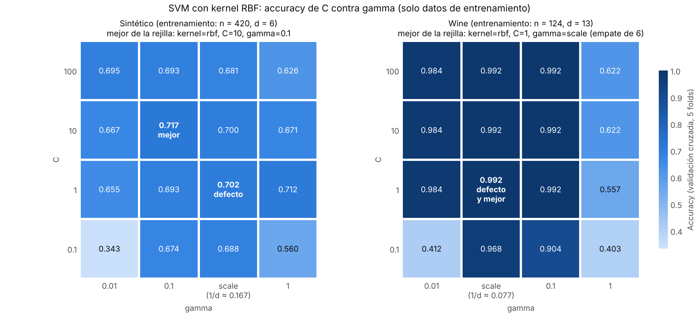

# SVM (Rol 5)

Cada apartado corresponde a una sección del reporte: *Cómo funciona* va en el marco teórico, *Resultados con la evaluación común* en resultados, *Ajuste de parámetros* y *Complejidad temporal* en las secciones del mismo nombre. La tabla de complejidad de los 6 modelos está aparte, en [`tabla_complejidad.md`](tabla_complejidad.md).

## Cómo funciona

Una máquina de vectores de soporte (SVM) separa las clases con la frontera que deja el mayor espacio libre posible entre ellas. En la práctica se usa `SVC` de scikit-learn mediante `crear_svm()` (`modelos/bibliotecas.py`), con sus valores por defecto: kernel RBF, C = 1 y gamma = "scale".

### Margen máximo

Para dos clases con etiquetas `y_i ∈ {−1, +1}`, una SVM lineal busca un hiperplano `w·x + b = 0` que las separe. Si los datos son separables hay infinitos hiperplanos que lo logran; la SVM elige el que queda más lejos de los puntos más cercanos de cada clase. Si se escalan `w` y `b` para que esos puntos más cercanos cumplan `y_i (w·x_i + b) = 1`, el ancho de la franja vacía entre las clases (el margen) vale `2 / ‖w‖`, así que maximizar el margen equivale a:

```
minimizar   ½ ‖w‖²
sujeto a    y_i (w·x_i + b) ≥ 1     para todo punto i
```

Es un problema de optimización cuadrática convexa: tiene un único óptimo global y no depende de una inicialización aleatoria. Los puntos que quedan justo en el borde del margen se llaman **vectores de soporte** y son los únicos que determinan la frontera: si se quita cualquier otro punto de entrenamiento, la solución no cambia. La idea de fondo es que una frontera con margen ancho tolera mejor pequeñas variaciones en los datos nuevos y por eso generaliza mejor.

### Variables de holgura y el papel de C

Con datos reales las clases se traslapan (en el dataset sintético, además, el 5 % de las etiquetas está cambiado a propósito) y ningún hiperplano cumple todas las restricciones. El **margen suave** agrega a cada punto una variable de holgura `ξ_i ≥ 0` que mide cuánto viola el margen:

```
minimizar   ½ ‖w‖² + C · Σ ξ_i
sujeto a    y_i (w·x_i + b) ≥ 1 − ξ_i,    ξ_i ≥ 0
```

- `ξ_i = 0`: el punto está bien clasificado y fuera del margen.
- `0 < ξ_i ≤ 1`: está dentro del margen, pero del lado correcto de la frontera.
- `ξ_i > 1`: está mal clasificado.

**C es el precio de cada violación** y decide el equilibrio entre un margen ancho y pocos errores de entrenamiento:

| | C pequeño | C grande |
|---|---|---|
| Violaciones del margen | se toleran | se castigan mucho |
| Margen | ancho | estrecho |
| Frontera | suave | se tuerce para acertar en casi todo el entrenamiento |
| Riesgo | subajuste (sesgo alto) | sobreajuste (varianza alta): también aprende los puntos ruidosos |

Además, en la forma dual del problema C es el tope de la influencia de cada punto (`0 ≤ α_i ≤ C`), por lo que un C moderado evita que unas pocas etiquetas equivocadas dominen la frontera.

### El truco del kernel

El problema se puede reescribir en su forma dual, con una variable `α_i` por punto de entrenamiento:

```
maximizar   Σ α_i − ½ Σ_i Σ_j α_i α_j y_i y_j (x_i·x_j)
sujeto a    0 ≤ α_i ≤ C,    Σ α_i y_i = 0
```

y la predicción queda `f(x) = signo( Σ α_i y_i (x_i·x) + b )`, donde solo cuentan los puntos con `α_i > 0`, es decir, los vectores de soporte. Lo importante es que los datos solo aparecen dentro de productos punto. Si se cambia `x_i·x_j` por una función kernel `K(x_i, x_j) = φ(x_i)·φ(x_j)`, se obtiene una SVM lineal en el espacio transformado `φ(x)` **sin calcular nunca `φ`**: ese es el truco del kernel. Una frontera recta en ese espacio es una frontera curva en el espacio original.

| Kernel | K(x, z) | Parámetros | Frontera |
|---|---|---|---|
| Lineal | `x·z` | C | hiperplano |
| Polinomial | `(γ · x·z + r)^p` | C, γ (`gamma`), p (`degree`), r (`coef0`, 0 por defecto) | superficie polinomial de grado p |
| RBF (gaussiano) | `exp(−γ ‖x − z‖²)` | C, γ (`gamma`) | curva, tan flexible como lo permita γ |

En el kernel RBF, `K` mide el parecido entre dos puntos: vale 1 si coinciden y decae con la distancia. **γ fija qué tan rápido decae**, o sea, el alcance de cada vector de soporte:

- γ grande: cada vector de soporte solo influye en su vecindad inmediata; la frontera se vuelve muy irregular y termina rodeando puntos individuales (sobreajuste).
- γ pequeño: cada vector de soporte influye lejos; la frontera es suave, casi lineal (subajuste si se exagera).

C y γ aumentan la flexibilidad del modelo y se compensan entre sí; por eso se ajustan juntos. El valor por defecto `gamma="scale"` es `1 / (d · Var(X))`; como el `Pipeline` ya estandariza los datos, `Var(X) = 1` y queda `gamma = 1/d`: 0.167 en el sintético (d = 6) y 0.077 en Wine (d = 13).

### Multiclase y escalado

- **Tres clases.** La SVM es binaria. `SVC` entrena un clasificador por cada par de clases (uno contra uno; con 3 clases son 3) y asigna la clase con más votos.
- **Escalado.** Los kernels dependen de productos punto y distancias, así que un rasgo con valores grandes dominaría el resultado (en Wine, la prolina vale cientos o miles y otros rasgos valen décimas). Por eso el `StandardScaler` va dentro del `Pipeline` de `evaluacion.py`, ajustado solo con la parte de entrenamiento de cada partición.

## Resultados con la evaluación común

SVM con valores por defecto, evaluada con `evaluar_holdout` y `evaluar_kfold` (las mismas particiones que los demás modelos). Precisión, recall y F1 con promedio macro; en K-Fold, promedio ± desviación estándar entre los 10 folds.

| Dataset | Validación | Accuracy | Precisión | Recall | F1 |
|---|---|---|---|---|---|
| Sintético | Hold-Out 70/30 | 0.6778 | 0.6844 | 0.6799 | 0.6771 |
| Sintético | K-Fold (k = 10) | 0.7033 ± 0.0470 | 0.7111 ± 0.0460 | 0.7048 ± 0.0465 | 0.6995 ± 0.0525 |
| Wine | Hold-Out 70/30 | 0.9815 | 0.9848 | 0.9778 | 0.9808 |
| Wine | K-Fold (k = 10) | 0.9778 ± 0.0369 | 0.9813 ± 0.0326 | 0.9763 ± 0.0373 | 0.9773 ± 0.0369 |

**Análisis.** En Wine la SVM casi no se equivoca: en Hold-Out acierta 53 de 54 muestras (un vino de la clase 2 clasificado como clase 1) y en K-Fold 174 de 178; con los rasgos estandarizados las tres clases quedan bien separadas. En el dataset sintético se queda alrededor de 0.68–0.70 (122 de 180 en Hold-Out, 422 de 600 en K-Fold). Ahí el límite lo pone el propio dataset: clases traslapadas (`class_sep=0.8`), 5 % de etiquetas cambiadas y un rasgo de puro ruido, así que ningún clasificador puede acercarse a 1. La clase 1 es la más difícil (sensibilidad de 0.56 en Hold-Out y 0.60 en K-Fold) y casi todos sus errores se van a la clase 0 (18 de sus 62 muestras en Hold-Out). La diferencia entre Hold-Out (0.678) y K-Fold (0.703) en el sintético cabe dentro de la variación entre particiones: la accuracy por fold va de 0.63 a 0.78. Por eso una sola partición Hold-Out no basta para comparar modelos con diferencias pequeñas.

## Ajuste de parámetros

Se buscó con `GridSearchCV(cv=5)` usando solo el 70 % de entrenamiento (partición estratificada con semilla 42, la misma de `evaluacion.py`); el 30 % de prueba no participa en la búsqueda. Como el escalado va dentro del `Pipeline`, en cada fold el `StandardScaler` se ajusta solo con la parte de entrenamiento de ese fold. Después, la mejor combinación y la de defecto se evaluaron una sola vez en el 30 % de prueba.

Rejilla: 52 combinaciones, es decir, 260 entrenamientos por dataset.

| Kernel | C | gamma | degree | Combinaciones |
|---|---|---|---|---|
| Lineal | 0.1, 1, 10, 100 | no lo usa | no lo usa | 4 |
| RBF | 0.1, 1, 10, 100 | scale, 0.01, 0.1, 1 | no lo usa | 16 |
| Polinomial | 0.1, 1, 10, 100 | scale, 0.01, 0.1, 1 | 2, 3 | 32 |

Se define una rejilla por kernel para no repetir entrenamientos idénticos (el kernel lineal ignora gamma y degree).

### Tabla: parámetros por defecto contra los mejores

| Dataset | Parámetros por defecto | Mejores parámetros | Accuracy CV (defecto → mejor) | Accuracy prueba (defecto → mejor) | Diferencia en prueba |
|---|---|---|---|---|---|
| Sintético | kernel=rbf, C=1, gamma=scale | kernel=rbf, C=10, gamma=0.1 | 0.7024 → 0.7167 (+0.0143) | 0.6778 → 0.6833 | +0.0056 |
| Wine | kernel=rbf, C=1, gamma=scale | kernel=rbf, C=1, gamma=scale (la de defecto) | 0.9920 → 0.9920 (0) | 0.9815 → 0.9815 | 0.0000 |

Los datos completos están en `resultados/ajuste_svm.csv` y las 52 combinaciones de cada dataset en `resultados/ajuste_svm_rejilla.csv`.

**¿Mejoran los resultados?** Casi nada: los valores por defecto de la SVM ya son muy buenos para estos dos datasets.

- **Wine: no mejora.** La configuración por defecto ya es la mejor de la rejilla: 0.9920 en validación cruzada, empatada con otras cinco combinaciones RBF (C ∈ {1, 10, 100} con gamma ∈ {scale, 0.1}). Ante un empate, `GridSearchCV` se queda con la primera combinación de la rejilla, que aquí es justamente la de defecto. En prueba acierta 53 de 54.
- **Sintético: mejora mínima, no concluyente.** En validación cruzada sube de 0.7024 a 0.7167 (+0.014) y en prueba de 0.6778 a 0.6833, que es exactamente una muestra más de 180 (de 122 a 123 aciertos). La desviación entre folds es de 0.05 a 0.06, varias veces mayor que la mejora, así que no se puede afirmar que la combinación ajustada sea realmente mejor. La de defecto queda en tercer lugar de 52.

### Mapa de calor: C contra gamma con kernel RBF



*Accuracy promedio de los 5 folds para cada par (C, gamma). Las columnas están ordenadas por el valor real de gamma (scale = 1/d). Archivo: `resultados/graficas/svm_mapa_calor_C_gamma.png`.*

- **Subajuste (C y gamma pequeños).** Con C = 0.1 y gamma = 0.01 la accuracy cae a 0.343 en el sintético y 0.412 en Wine, prácticamente lo mismo que predecir siempre la clase más frecuente (0.340 y 0.403). El margen es tan ancho y la frontera tan suave que el modelo no separa nada.
- **Sobreajuste (gamma grande).** Con gamma = 1 en Wine la accuracy de entrenamiento es 1.000 (para C ≥ 1) pero la de validación cae a 0.557–0.622: el modelo memoriza. En el sintético, C = 100 con gamma = 1 da 0.995 en entrenamiento y 0.626 en validación.
- **C y gamma se compensan.** En el sintético las mejores celdas forman una diagonal: (C = 1, gamma = 1) con 0.712, (C = 10, gamma = 0.1) con 0.717 y (C = 100, gamma = 0.01) con 0.695. Si uno sube, el otro tiene que bajar.
- **Por qué `gamma="scale"` funciona bien sin ajustar.** Con rasgos estandarizados, la distancia al cuadrado entre dos puntos vale en promedio 2d, así que gamma = 1/d deja el exponente del kernel cerca de −2 sin importar cuántos rasgos haya. En cambio, gamma = 1 en Wine (d = 13) lleva el exponente a cerca de −26: el kernel vale casi 0 entre puntos distintos y cada punto solo se parece a sí mismo.

### Comparación por kernel

Mejor accuracy de validación cruzada que alcanza cada kernel:

| Kernel | Sintético | Wine |
|---|---|---|
| Lineal | 0.650 (casi igual con cualquier C: de 0.648 a 0.650) | 0.984 (C = 0.1) |
| RBF | 0.717 (C = 10, gamma = 0.1) | 0.992 (6 combinaciones empatadas) |
| Polinomial | 0.614 (grado 2; por ejemplo, C = 100 con gamma = scale) | 0.976 (grado 3, C = 1, gamma = 0.1) |

- En **Wine** los tres kernels funcionan (0.976 a 0.992): las clases son casi linealmente separables y el kernel lineal ya llega a 0.984.
- En el **sintético** el kernel lineal se queda en 0.65 tanto en entrenamiento como en validación, que es subajuste: cada clase está formada por 2 grupos y una frontera recta no puede separarlos. El RBF sí puede curvar la frontera y llega a 0.717.
- El **polinomial** queda incluso por debajo del lineal en el sintético. La causa es que scikit-learn usa `coef0 = 0` por defecto, y entonces el polinomio solo tiene términos de grado exactamente p (con p = 2 no puede representar ni una frontera recta). `coef0` no formaba parte de la rejilla acordada; en una comprobación aparte, fuera de `ajuste_parametros.py` (grados 2 y 3, C ∈ {0.1, 1, 10}, gamma ∈ {scale, 0.1}), con `coef0 = 1` el polinomial sube a 0.70–0.71 en el sintético y a 0.992 en Wine, al nivel del RBF.

### Cómo se podría afinar más

- Una segunda rejilla más fina, en escala logarítmica, alrededor de la mejor zona (por ejemplo C ∈ {3, 10, 30} y gamma ∈ {0.03, 0.1, 0.3}), o `RandomizedSearchCV` con distribuciones log-uniformes de C y gamma.
- Repetir la validación cruzada con varias semillas (`RepeatedStratifiedKFold`) para que diferencias de 0.01 no dependan de cómo cayó la partición.
- Decidir siempre con validación cruzada sobre los datos de entrenamiento; el conjunto de prueba se usa una sola vez, al final.

## Complejidad temporal

Notación: n = puntos de entrenamiento, d = rasgos, s = vectores de soporte.

- **Entrenamiento: entre O(n²·d) y O(n³).** Entrenar una SVM es resolver el problema cuadrático dual, que tiene una variable `α_i` por cada punto de entrenamiento. `SVC` usa libsvm, que lo resuelve con un método iterativo (tipo SMO): en cada paso ajusta dos `α` y actualiza el resto en O(n). El costo tiene dos partes: calcular el kernel entre pares de puntos, O(n²·d), y las iteraciones, cuyo número crece con n y lleva el total a algo entre cuadrático y cúbico. Cuántas iteraciones hacen falta depende de los datos, de C y del kernel: con clases separadas y C moderado converge rápido; con C grande necesita muchas más.
- **Predicción: O(s·d) por punto.** La predicción es `f(x) = Σ α_i y_i K(x_i, x) + b` sobre los vectores de soporte: un kernel, de costo O(d), por cada uno. s es a lo más n y crece con el ruido y el traslape, porque todo punto que viola el margen es vector de soporte.
- **Memoria: O(s·d)** para guardar los vectores de soporte; durante el entrenamiento, hasta O(n²) para la caché del kernel (libsvm la limita a 200 MB; con n = 420 la matriz completa ocupa menos de 2 MB).

**Lo que se observó en la práctica** (tiempos de `resultados/ajuste_svm_rejilla.csv`, columna `mean_fit_time`; cambian de una computadora a otra, pero la proporción se mantiene):

- En el sintético (336 puntos por fold), un entrenamiento con kernel RBF tarda unos milisegundos (entre 4 y 9 ms), pero el polinomial de grado 3 con C = 100 y gamma = 1 tarda decenas de segundos (32 s en la corrida registrada): miles de veces más con exactamente los mismos datos. Esa sola combinación consume alrededor del 85 % del tiempo de entrenamiento de toda la búsqueda. Es la evidencia de que el costo de entrenar una SVM no depende solo de n, sino también de C y del kernel.
- En Wine (unos 99 puntos por fold) todos los entrenamientos tardan unos milisegundos.
- Vectores de soporte de la SVM por defecto entrenada con el 70 %: 282 de 420 en el sintético (67 %) y 57 de 124 en Wine (46 %). Con la configuración ajustada en el sintético bajan a 248 (59 %). En el dataset ruidoso la SVM usa dos de cada tres puntos de entrenamiento para predecir, así que su costo es del mismo orden que el de K-NN, que los usa todos; con datos limpios s es mucho menor que n y la SVM predice más rápido.
